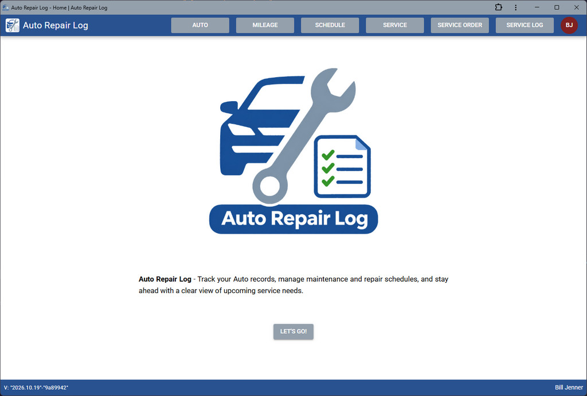
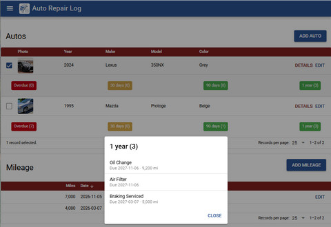
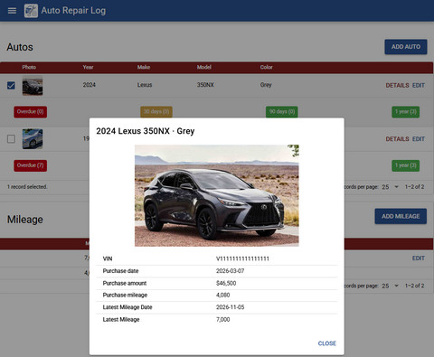
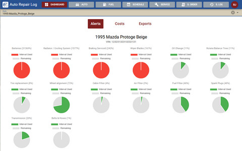
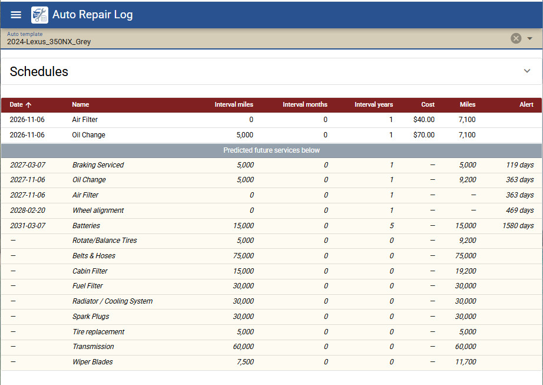
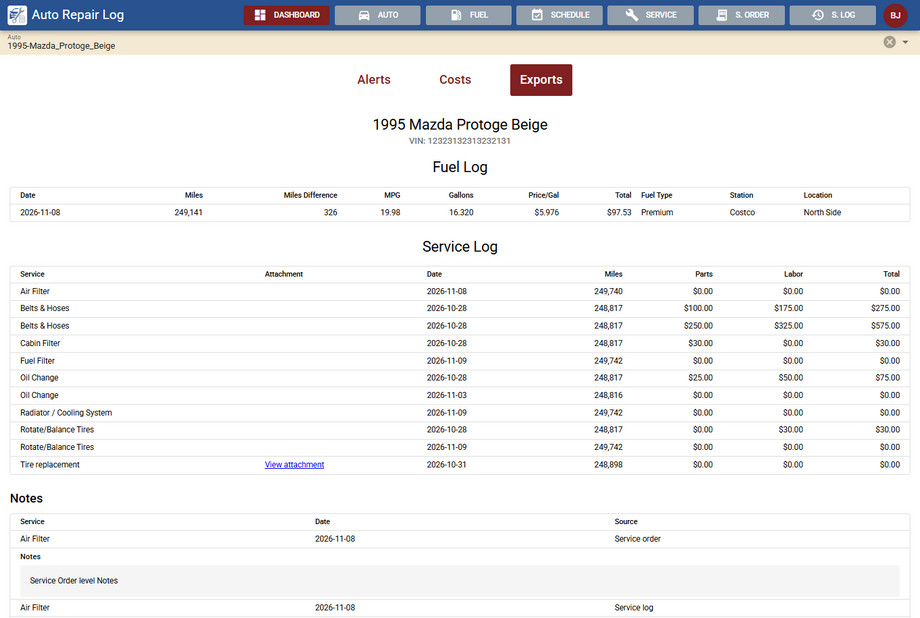

# 🚗 Auto Repair Log

> 🚀 **[Open the live app](https://autorepairlog.com)**

> **Track your Auto records, manage maintenance and repair schedules all in one organized dashboard. Stay ahead with a clear view of upcoming service needs.**

Auto Repair Log helps organize maintenance history and estimate future service needs. Estimates depend on the records provided.

By combining historical records with mileage-based and calendar-based estimates, the application helps users:

- Keep vehicle records organized.
- Plan maintenance ahead of time.
- Reduce missed service intervals.
- Monitor repair and maintenance expenses.
- Keep documentation for warranty and resale purposes.

## ✨ Features

### 🔧 Maintenance & Repairs

- Track maintenance and repair history.
- Manage service schedules and recurring maintenance intervals.
- Record service costs and summarize repair expenses.
- Access maintenance records for future reference or vehicle resale.
- Attach invoices or warranty documents to service orders as PDF or image files.
- Dictate notes in supported browsers using the microphone. Dictated text is appended to existing
  notes; browser speech recognition may send audio to the browser provider for processing.

### 📅 Scheduling & Predictions

- Estimate upcoming maintenance based on mileage accumulation.
- Predict service dates using mileage and calendar-based intervals.
- Identify overdue, upcoming, and completed maintenance.
- Configure mileage-based and time-based service intervals.
- Manage reusable maintenance schedule templates.

### 🚘 Vehicle Management

- Maintain records for multiple vehicles.
- Track vehicle mileage history and driving-rate trends.
- Organize maintenance schedules by vehicle.
- Support manufacturer-specific maintenance recommendations.

### 📊 Insights & Reporting

- View maintenance status through dashboard summaries.
- Review historical maintenance and upcoming service requirements.
- Analyze service costs and repair expenses.
- Export fuel and service records as CSV or PDF when Dashboard is available.

### 🔔 Reminders & Notifications

- Review estimated service intervals in Dashboard Alerts.
- Receive in-app notifications for past-due services when maintenance tracking and in-app
  notifications are enabled and the service permits notifications.

### ⚙️ Profile preferences and sharing

- Turn fuel tracking and maintenance tracking on or off in Profile. Disabling maintenance tracking
  hides its pages and Dashboard Alerts and stops maintenance notifications; disabling fuel tracking
  hides Fuel navigation.
- Manage shared-user email entries in Profile. When both users list each other's verified account
  email, each can view and edit the other's autos and related records. Removing either entry
  revokes the shared access.
- Deploy [profile-sharing-access.sql](src/sql/profile-sharing-access.sql) and
  [profile-sharing-policies.sql](src/sql/profile-sharing-policies.sql) with the app. Review
  existing database and storage policies before deployment; permissive policies can override
  access restrictions.

## Screenshots

### Autos and service badges

### Auto details

### Service alerts

### Service schedule

### Cost reports and data exports

